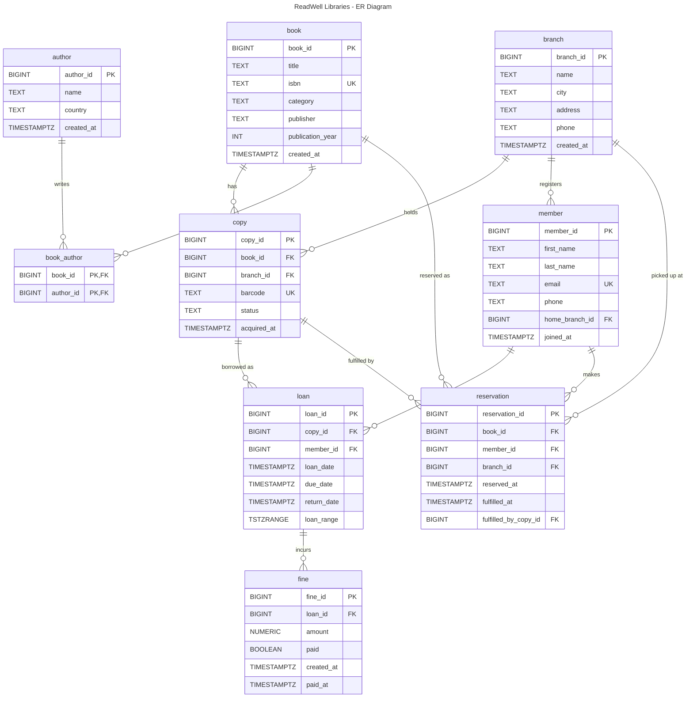

# ReadWell Libraries — ER Diagram (Mermaid)

This is the **only** ER diagram file for Portfolio 1. It is plain Mermaid text
(no images), so it renders in any Markdown viewer that supports Mermaid and can
be diffed in git.

## Legend

| Marker | Meaning |
|--------|---------|
| `PK`   | Primary Key |
| `FK`   | Foreign Key |
| `PK,FK`| Part of a composite primary key that is also a foreign key |
| `UK`   | Unique constraint |
| `||--o{` | One-to-many: one parent row → zero or more child rows |

## Notes on the model

- A `book` is a *logical* title (an ISBN); a `copy` is the *physical* artefact on a shelf. The exclusion constraint on `loan` therefore keys on `copy_id`, not `book_id`.
- `book_author` is a pure many-to-many junction table (composite PK `book_id, author_id`) so a book may have several authors and vice-versa.
- `loan.loan_range` is a `TSTZRANGE`; the GiST `EXCLUDE` constraint prevents a copy being on two overlapping loans at once.
- `reservation.fulfilled_by_copy_id` is nullable: it stays NULL until a staff member assigns a physical copy to fulfil the reservation.
- `fine` is its own table (not a column on `loan`) because a loan may have zero, one, or several fines, and the fine lifecycle (paid / paid_at) is independent of the loan lifecycle.
