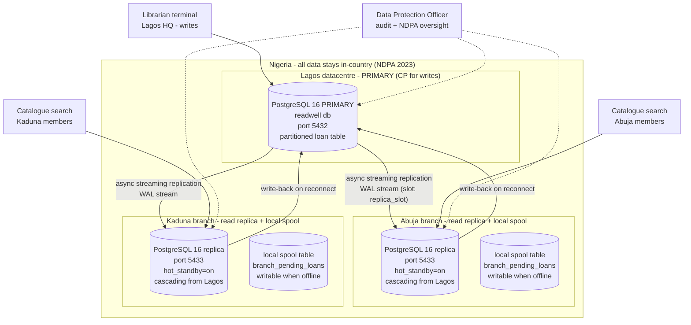

# 04_cloud_architecture.md — Portfolio 5

**ReadWell Libraries — Distributed & Cloud Database Architecture**
Student: Nuhu Simbiat — 2026/A/MIT/0955 — Miva Open University, MIT 8103 Advanced Database Systems

This document specifies the distributed / cloud database design for ReadWell
Libraries, a simulated public library network with branches in **Lagos (Yaba,
Ikeja), Abuja (Garki), and Kaduna**. It maps the design onto the **NDPA 2023**
(Nigeria Data Protection Act 2023), the **CAP theorem**, the
**sync-vs-async replication** trade-off, and a **branch-offline** design that
keeps every branch working when the internet is down.

---

## 1. Architecture (Mermaid)



### Why on-prem per branch, not a hyperscaler region?

There is currently **no major hyperscaler (AWS / Azure / GCP) region physically
located inside Nigeria**. The closest AWS region is `af-south-1` (Cape Town,
South Africa), and the closest Azure region is `South Africa North` (Johannesburg).
Routing ReadWell member data to either would be a **cross-border transfer**
under **NDPA 2023 Sections 41-43**: allowed only with an adequacy finding or an
approved instrument (e.g. standard contractual clauses). The NDPA does not ban
foreign hosting outright, but keeping the data in Nigeria removes that whole
compliance burden, so it is the design choice made here.

ReadWell's design therefore uses:

1. **A Lagos datacentre as the PRIMARY** — single logical writer for all
   write transactions (loans, returns, reservations, fines).
2. **An on-prem PostgreSQL 16 instance per branch** — physical/cascading
   streaming replica for the online catalogue search (Availability + Partition
   tolerance).
3. **A licensed Nigerian cloud provider** (e.g. a Tier-III Nigerian DC such as
   MDXi / Rack Centre / MTN NCN) could host the Lagos PRIMARY on a managed
   PostgreSQL offering if ReadWell ever outgrows self-hosting — the data still
   stays inside Nigeria, so NDPA 2023 is still satisfied.

This is honest about the constraint: the architecture is **"private cloud
on-prem in Nigeria + async streaming replication to branches"**, not
" hyperscaler region X". A future Nigerian-region hyperscaler (Microsoft has
announced plans for an Azure Nigeria region) would slot straight in.

---

## 2. NDPA 2023 compliance

The Nigeria Data Protection Act 2023 (NDPA 2023) is the primary legal basis.
ReadWell's compliance posture:

| NDPA 2023 principle | How the design satisfies it |
| --- | --- |
| **Data residency (cross-border transfer rules, Sections 41-43)** | All data stays on physical machines inside Nigeria (Lagos, Abuja, Kaduna datacentres). No copy ever leaves Nigeria. No AWS `af-south-1` or Azure South Africa North usage. |
| **Lawful basis of processing** | Performance of a contract (member registration, book lending) under Section 25 of the NDPA 2023 (lawful basis). Members sign a privacy notice at registration that lists the data collected and the lawful basis. |
| **Data controller** | ReadWell Libraries is the Data Controller; the Lagos datacentre team is the Data Processor for the branches. A **Data Protection Officer (DPO)** is appointed (Section 32 of the Act) and is named in the privacy notice. |
| **Data subject rights — access (Section 34)** | Members can request their full loan history by visiting any branch. The librarian runs a parameterised `SELECT` against the primary `loan` partition filtered by `member_id` (partition pruning by `loan_date` keeps it fast). |
| **Data subject rights — erasure (Section 34)** | Members can request erasure of their PII. ReadWell applies a pseudonymisation function (replace `first_name`, `last_name`, `email`, `phone` with redacted tokens) while retaining the `loan`, `fine`, and `reservation` records for a 7-year retention period set in ReadWell's own retention policy (fine records are financial records), justified under the storage-limitation principle in Section 24 - the NDPA itself does not fix a number of years. |
| **Encryption at rest** | PostgreSQL data dir on a LUKS-encrypted volume; column-level encryption for `member.email` and `member.phone` using `pgcrypto`'s `pgp_sym_encrypt`. |
| **Encryption in transit** | TLS between branches and Lagos (not the socket demo in Portfolio 5 — the production deployment runs `hostssl` in `pg_hba.conf` and uses Let's Encrypt certificates on the FQDN of each node). |
| **Breach notification within 72 hours (Section 40)** | The DPO monitors the audit log; any unauthorized INSERT/UPDATE/DELETE on `member`, `loan`, or `fine` triggers a Sentinel alert that auto-pages the DPO, who must notify the Nigeria Data Protection Commission within 72 hours. |
| **Access control & audit logging** | Role-based access: `librarian` role can `INSERT` into `loan` / `reservation`; `member_services` role can `SELECT` member PII; `dpo_audit` role is the only one that can `SELECT` from `audit_log`. `pgAudit` extension logs every DML. |
| **Data Protection Impact Assessment (DPIA)** | A DPIA is on file for the lending system; it is reviewed annually or whenever a new branch is added. |

---

## 3. CAP analysis

The CAP theorem (Brewer) says a distributed system can guarantee at most **two
of {Consistency, Availability, Partition tolerance}** when the network
partitions. ReadWell picks differently for each subsystem:

| Subsystem | Choice | Why |
| --- | --- | --- |
| **Catalogue search (read-only, at every branch)** | **AP** — Available + Partition-tolerant | A branch whose internet link is down must still let members search the catalogue. The branch's local replica keeps answering `SELECT`s even when it cannot reach Lagos. Eventual consistency on reads is acceptable (the catalogue is at most seconds stale). |
| **Loan / borrow transaction (the primary write path)** | **CP** — Consistent + Partition-tolerant | Only Lagos accepts writes; if Lagos is unreachable the loan is queued locally at the branch (see §5) and replayed later, never written directly to the local replica. This guarantees the EXCLUDE constraint on `loan` is enforced once and only once, so the same physical copy cannot be loaned twice. |
| **Fines & reservations (write path)** | **CP** (same as loan) | Single writer = Lagos. Local replicas never accept writes (the Portfolio 5 replica demo shows PostgreSQL rejecting `INSERT` on a read-only transaction). |

ReadWell explicitly does **not** try to be CA for any subsystem — network
partitions are real in Nigeria (fibre cuts, ISP outages), so Partition
tolerance is non-negotiable.

---

## 4. Sync vs async replication trade-off

| | Synchronous (e.g. `synchronous_commit=on` + `synchronous_standby_names`) | Asynchronous (default; what ReadWell uses) |
| --- | --- | --- |
| **RPO (data loss on primary failure)** | Zero — the primary does not commit until the replica has flushed WAL. | Small — up to the last few seconds of WAL not yet replayed. |
| **Write latency** | Higher — every COMMIT waits for a round-trip to the replica. | Lowest — COMMIT returns as soon as the local WAL is flushed. |
| **Branch-down behaviour** | If any sync replica is unreachable, writes **block** on the primary — fatal for ReadWell, whose branches have flaky internet. | Primary keeps accepting writes; replica catches up on reconnect. |
| **Best for** | Financial ledgers, two-datacentre HA inside one DC. | Distributed branches, read scaling, catalogue search. |

**ReadWell picks ASYNC streaming replication.** A branch going offline never
stops the primary from accepting new loans at other branches. The trade-off
is a small RPO window (seconds of loan data could be lost if Lagos burns down
between a COMMIT and the next WAL flush to Abuja). Mitigations:

* Continuous WAL archiving to object storage inside Nigeria (daily PITR base
  backup + WAL archive in a separate Lagos DC rack).
* A **local write-ahead spool** at each branch (see §5) ensures that even if
  the branch itself is offline, no member-facing loan is silently lost — it
  is replayed on reconnect.
* Conflict resolution is **primary-wins**: when a branch replays a queued
  loan and the overlap guard (`trg_no_overlapping_loan`)
  rejects it (because someone at another branch already loaned that copy),
  the branch librarian is shown the conflict and must offer the member a
  reservation instead.

---

## 5. Branch-offline design

When a branch (e.g. Kaduna) loses its internet link to Lagos:

1. **The branch's local PostgreSQL replica stays up** in `hot_standby=on`
   mode. Members can still **search the catalogue** against the local copy.
   The replica answers `SELECT`s normally (AP).
2. The branch's librarian cannot write to the read-only replica — PostgreSQL
   rejects any `INSERT` with `cannot execute INSERT in a read-only
   transaction` (this is the exact behaviour the Portfolio 5 Demo 1 shows).
3. To keep the branch **functional for lending**, each branch runs an extra
   small **writable** database (or schema) on the same instance, called
   `branch_pending_loans`:

   ```sql
   CREATE TABLE branch_pending_loans (
       spool_id    BIGSERIAL PRIMARY KEY,
       copy_id     BIGINT NOT NULL,
       member_id   BIGINT NOT NULL,
       loan_date   TIMESTAMPTZ NOT NULL DEFAULT NOW(),
       due_date    TIMESTAMPTZ NOT NULL,
       status      TEXT NOT NULL DEFAULT 'queued'
                   CHECK (status IN ('queued','replayed','conflict')),
       error_msg   TEXT,
       queued_at   TIMESTAMPTZ NOT NULL DEFAULT NOW(),
       replayed_at TIMESTAMPTZ
   );
   ```
4. When a member borrows a copy at the offline branch, the librarian inserts
   into `branch_pending_loans` (local, writable), not into `loan`. The branch
   issues a **provisional loan receipt** to the member.
5. **On reconnect**, a background worker at the branch replays each queued
   row against the primary (`INSERT INTO loan ...`). The primary either:
   * accepts it (the copy was free) → row marked `replayed`; or
   * rejects it with the overlap guard's `exclusion_violation` error → row marked
     `conflict` and `error_msg` recorded; the librarian contacts the member
     to return the copy and offers a reservation.
6. After replay, the branch's replica catches up via the WAL stream and the
   branch is back to "fresh catalogue" reads.

This design gives the branch **AP for reads (catalogue)** and **CP for the
eventual consistency of writes (loan replay)** — it satisfies both the
"member can still borrow when the internet is down" business requirement
**and** the "a copy cannot be loaned twice" invariant in the schema.

---

## 6. Sharding / partitioning rationale

| Technique | Where applied | Why |
| --- | --- | --- |
| **RANGE partitioning on `loan.loan_date`, monthly** (Portfolio 5) | The `loan` table — partitions `loan_YYYYMM` for the last 24 months + next 2 months. | The hottest query is "current month's loans / overdue fines". Partition pruning means a query with `WHERE loan_date >= this_month` scans only **one** ~30-day partition, not years of history. Old partitions can be **detached and archived** (`ALTER TABLE loan DETACH PARTITION loan_202209`) for the 7-year NDPA retention without touching live data. |
| **Overlap guard trigger `trg_no_overlapping_loan` (replaces the EXCLUDE constraint after partitioning)** | Row trigger on the partitioned parent; takes `pg_advisory_xact_lock(copy_id)` then checks every partition for an overlapping `loan_range`. | PostgreSQL 16 cannot put an EXCLUDE constraint on a partitioned table, and a loan that starts on 25 March and runs into April overlaps loans in BOTH partitions, so a per-partition constraint would miss it. The trigger checks across all partitions; tested in `01_partitioning.sql` (OVERLAP TEST PASS). |
| **Physical read replicas per branch** (this portfolio) | Lagos = primary, Abuja + Kaduna = streaming replicas. | Read-scaling for catalogue search AND branch-offline resilience. |
| **Optional future: sharding by `branch_id`** (not implemented here) | If write volume ever exceeds one Lagos primary, shard the `copy` and `loan` tables by `branch_id` so each branch owns its own copies. | Would give **write locality** (a branch writes to its own shard). Not needed today — Lagos handles the load comfortably. |

---

## 7. Mapping to study sessions

| Component in this design | Study session concept demonstrated |
| --- | --- |
| Monthly RANGE partitioning of `loan` + EXPLAIN showing pruning | **Study Session 2 — Distributed DB**: horizontal partitioning, partition pruning |
| Primary + streaming read replica (`pg_basebackup -R -S replica_slot`) | **Study Session 2 — Distributed DB**: physical replication, WAL shipping, hot standby |
| Replica rejects `INSERT` ("cannot execute INSERT in a read-only transaction") | **Study Session 2 — Distributed DB**: read-only standby, single-writer invariant |
| Catalogue search = AP, loan write = CP (§3) | **Study Session 2 — Distributed DB**: CAP theorem trade-offs |
| Sync vs async replication trade-off (§4) | **Study Session 2 — Distributed DB**: ACID vs BASE, RPO/RTO, sync vs async replication |
| Local spool table at offline branch (§5) | **Study Session 2 — Distributed DB**: eventual consistency, conflict resolution |
| Branch-offline design (§5) | **Study Session 2 — Distributed DB**: network partition tolerance |
| On-prem per branch + Lagos primary = "private cloud in Nigeria" | **Study Session 3 — Cloud DB**: cloud-vs-on-prem, data-sovereignty constraints |
| NDPA 2023 data residency, subject rights, breach notification, DPO (§2) | **Study Session 6 — Data Privacy / NDPA 2023** |
| Encryption at rest (LUKS + pgcrypto) and in transit (TLS) | **Study Session 6 — Data Privacy / NDPA 2023** |
| `pgAudit` + role-based access + DPO oversight | **Study Session 6 — Data Privacy / NDPA 2023** |

---

## 8. Run commands (recap)

```bash
# 1. Partitioning
sudo runuser -u postgres -- psql -d readwell \
  -f portfolio-5-distributed-cloud/01_partitioning.sql

# 2. Replica setup (manual)
bash portfolio-5-distributed-cloud/02_replica_setup.sh

# 3. Replica demonstrations (paste real output into the file)
sudo runuser -u postgres -- psql -d readwell -f \
  portfolio-5-distributed-cloud/03_replica_demo.sql
```

— End of 04_cloud_architecture.md —
